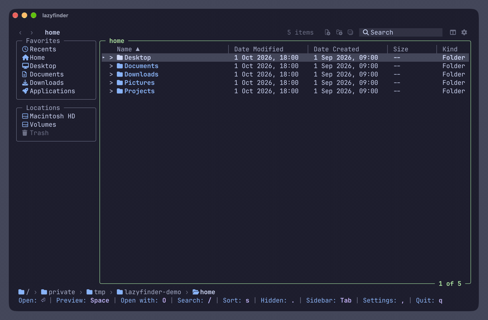
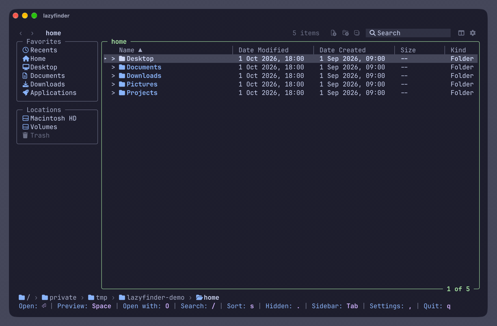
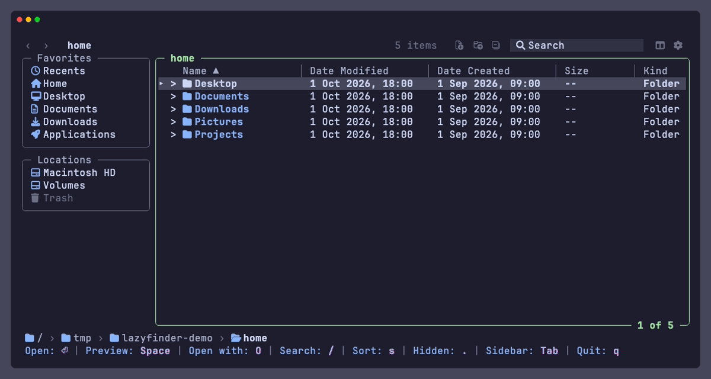
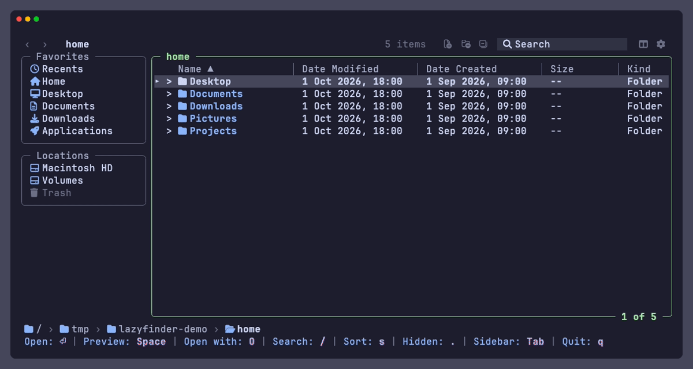
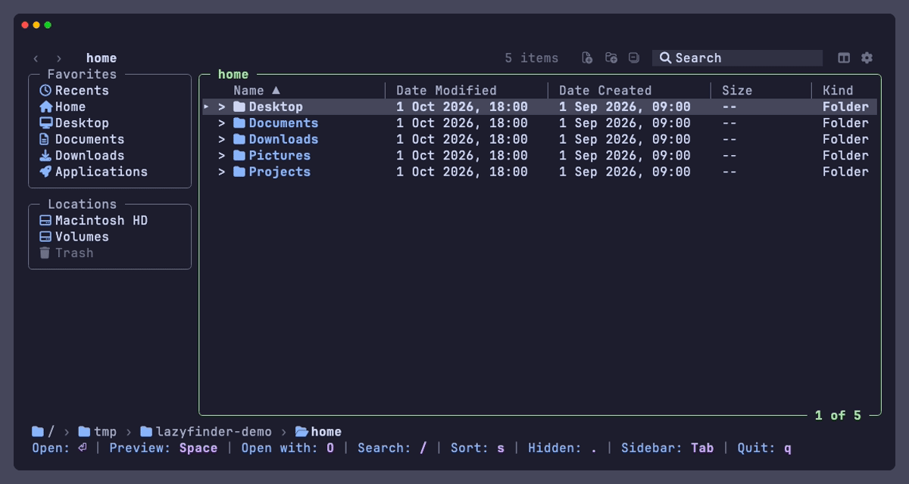
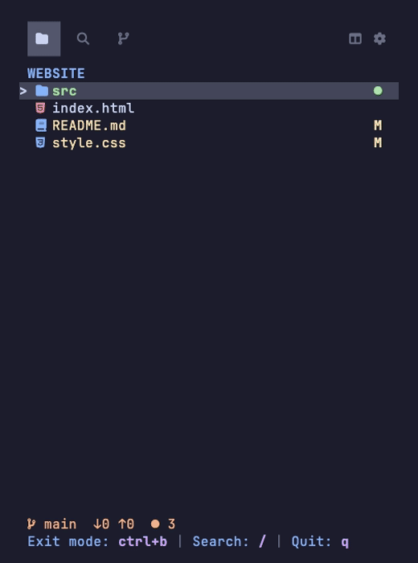
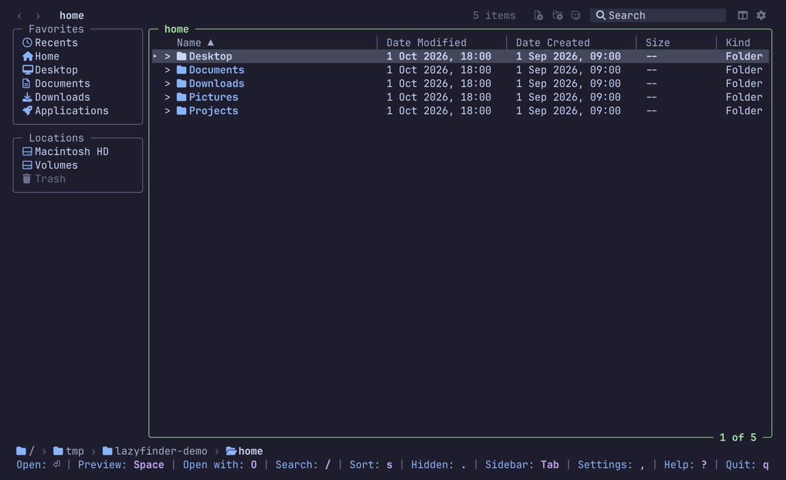
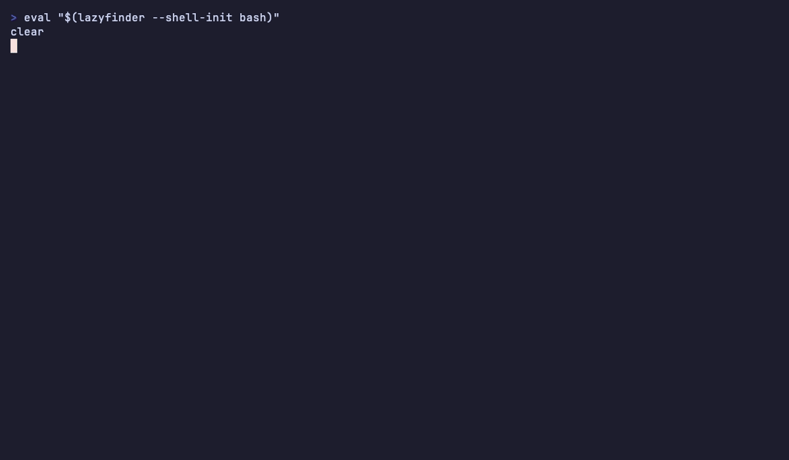
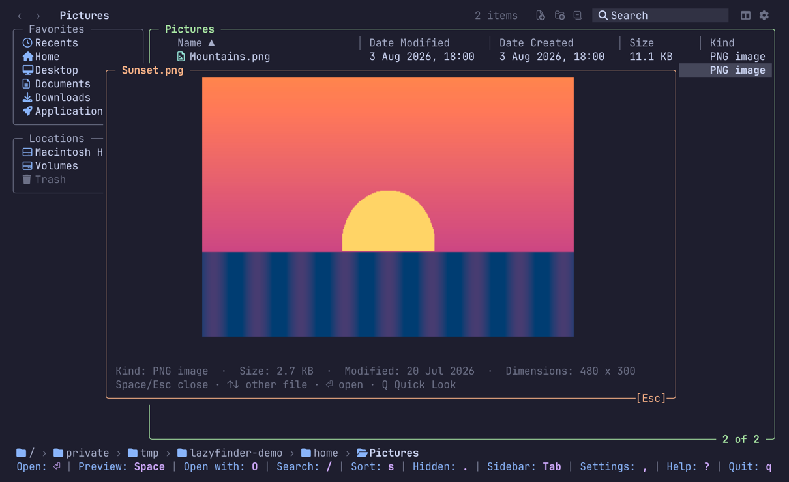

<div align="center">

# lazyfinder

**A lazy file manager for the terminal, like Finder, without leaving it.**

Columns, a sidebar, a Space preview popup and open-with, with keyboard and mouse.

[](https://github.com/MathiasDrizzy/lazyfinder/actions/workflows/ci.yml)
[](go.mod)
[](LICENSE)


[Install](#install) · [Quick start](#quick-start) · [Keys](#keys) · [Configuration](#configuration)

</div>

## What is lazyfinder?

A file manager that runs inside your terminal and looks like the macOS Finder: Favorites on the left, your files in
sortable columns, and the path at the bottom. Move with the arrow keys or the mouse, press `Space` to look inside a
file, and `Enter` to open it with the program you choose. You never leave the terminal.

- **Nothing to learn.** If you have used Finder, you already know the layout. `?` lists every key.
- **Safe.** Deleting moves to the Trash, and `u` undoes the last change.
- **Works next to your editor.** A narrow sidebar mode follows your project as you work.

## What it does

### Look inside files with Space

`Space` opens a preview without starting any program: rendered Markdown, highlighted code, the contents of a zip,
pictures in terminals that can draw them. `↑` `↓` move to the next file while the preview stays open.



### Open with the program you choose

`Enter` opens a file with its program: your editor for text, Preview for pictures, Excel for a spreadsheet. `O` shows
every program that can open it, so you can pick another one. A program runs only if you set it up; in these GIFs text
files open in [micro](https://micro-editor.github.io).



### Create, rename, copy and delete

`N` makes a folder and `n` a file, `R` renames, `c` `x` `p` copy, cut and paste, `d` moves to the Trash and `u`
undoes. Nothing is overwritten or deleted for good.



### Find files

`/` searches while you type. `Tab` widens the search from this folder to its subfolders or the whole disk, and
filters such as `kind:image` narrow it. More in [docs/search.md](docs/search.md).



### Tabs and favorites

`ctrl+t` opens a tab and `{` `}` move between tabs. `b` adds a folder to Favorites, `E` lists the files and folders
you opened lately.



### A sidebar next to your terminal

`lazyfinder --sidebar` is a narrow tree of your project, like the file explorer of VS Code. Put it on the left of
your terminal (the [herdr plugin](#a-sidebar-in-every-herdr-tab) docks it by itself, or a split in Ghostty or any
terminal) and keep working on the right: files you create, edit or stage there show up at once, each with its git
letter (`M` modified, `U` new, `A` staged).


### A sidebar in every herdr tab

lazyfinder is also a [herdr](https://herdr.dev) plugin. Install it once:

```sh
herdr plugin install MathiasDrizzy/lazyfinder
```

Every tab then opens with lazyfinder in sidebar mode on one side and your terminal on the other. The sidebar follows
the folder of the terminal next to it: `cd` there and the tree moves with you. A folder you open by hand in the
sidebar stays until the terminal changes folder again. "Sidebar in herdr" in Settings puts it on the left or the right
of new tabs, and the plugin's **Toggle lazyfinder** action (bind it to a key in herdr) opens, focuses or closes it;
closed with the action, it stays closed in that tab. `herdr.auto_open` and `herdr.width` in `config.json` turn the
automatic opening off and set its width. To toggle it with `prefix` and `e`, add this to herdr's `config.toml`:

```toml
[[keys.command]]
key = "prefix+e"
type = "plugin_action"
command = "lazyfinder.toggle"
```

`herdr plugin install` builds lazyfinder with Go, or uses the `lazyfinder` you installed. `herdr plugin link` (a local
clone) does not build: run `sh scripts/herdr-build.sh` in the clone once, and again after you change the code.

If you use the [herdr-sidebar](https://github.com/alexarthurs/herdr-sidebar) plugin, turn off **Auto-open** in its
Settings (`s`), or disable it with `herdr plugin disable herdr-sidebar`, so new tabs do not get two sidebars.

Run outside the plugin, lazyfinder starts in the normal window, and `ctrl+b` or `--sidebar` gives the sidebar mode as
always.

### Git at a glance

The **Git** tab of the sidebar lists what changed: staged files, changes and stashes. `Enter` shows the diff of a
file. It only shows; you commit in your terminal, or press `L` to open [lazygit](https://github.com/jesseduffield/lazygit).



### Themes and languages

`,` opens Settings. Pick one of 14 themes (Catppuccin, Nord, Tokyo Night and more), one of eight languages, the
columns, the icons and the row density. Changes apply at once and are saved.



### Stay in the folder when you quit

A program cannot move the shell that started it, so this needs one line in your shell's startup file. Without it,
quitting leaves you where you started, even with "Stay in the folder on exit" on in Settings (the row then says
"needs shell"). `brew install` does not add the line for you:

```sh
eval "$(lazyfinder --shell-init zsh)"     # in ~/.zshrc
eval "$(lazyfinder --shell-init bash)"    # in ~/.bashrc
lazyfinder --shell-init fish | source     # in ~/.config/fish/config.fish
```

Open a new terminal, and quitting lazyfinder leaves your shell in the folder you were looking at.



### Pictures in the preview

In Ghostty, kitty and WezTerm the preview shows the picture itself. In other terminals it says so, and `Q` opens Quick
Look on macOS.



## Install

Install a [Nerd Font](https://www.nerdfonts.com/) in your terminal for the icons (or set `icons` to `emoji`, `ascii`
or `off`). Building needs Go 1.27.2 or newer. lazyfinder runs on macOS and Linux.

**With Go**

```sh
go install github.com/MathiasDrizzy/lazyfinder/cmd/lazyfinder@latest
```

**From source**

```sh
git clone https://github.com/MathiasDrizzy/lazyfinder.git
cd lazyfinder
go build -o lazyfinder ./cmd/lazyfinder
```

**Homebrew (macOS)**

```sh
brew install mathiasdrizzy/tap/lazyfinder
```

**Prebuilt binaries** for macOS and Linux are on the [Releases page](https://github.com/MathiasDrizzy/lazyfinder/releases).
`lazyfinder --version` prints the version you have. Each release lists its checksums in `checksums.txt`, with an SBOM
and a build provenance attestation per archive; [SECURITY.md](SECURITY.md#verifying-a-release) shows how to verify a
download.

Shell completions and the manual page:

```sh
lazyfinder --completions zsh > "${fpath[1]}/_lazyfinder"   # or bash, or fish
man ./docs/lazyfinder.1
```

## Quick start

```sh
lazyfinder              # starts in the current folder
lazyfinder ~/Projects   # starts in a folder
lazyfinder --sidebar .  # the narrow sidebar of a project
```

Press `?` for every key and gesture, `Space` to look at a file and `q` to quit.

## Keys

The essentials. `?` shows all of them, and [docs/keybindings.md](docs/keybindings.md) has the full list.

| Key | Action |
| --- | --- |
| `↑` `↓` / `k` `j` | Move the selection |
| `Enter` / `→` / `l` | Enter a folder or open a file |
| `Backspace` / `←` / `h` | Go to the parent folder |
| `[` `]` | Back and forward in history |
| `Space` / `O` | Preview popup / Open With menu |
| `/` | Search |
| `N` `n` / `F2` | New folder, new file / Rename |
| `c` `x` `p` / `d` / `u` | Copy, cut, paste / Move to the Trash / Undo |
| `ctrl+t` / `b` / `E` | New tab / Add to Favorites / Recents |
| `M` / `Ctrl+B` | Column view / Sidebar mode |
| `,` / `?` | Settings / Help |
| `q` | Quit |

Every key can be rebound with `keys` in `config.json`. The mouse does the same: click rows, headers, sidebar entries,
breadcrumb segments and the back and forward buttons. A right click on a breadcrumb segment copies the path of that
folder.

## Configuration

Most things are in Settings (`,`) and are saved at once. The config is one JSON file: `$LAZYFINDER_CONFIG`, else
`$XDG_CONFIG_HOME/lazyfinder/config.json`, else `~/.config/lazyfinder/config.json`. Without a file the defaults apply,
and a file with only what you want to change is enough:

```json
{
  "version": 1,
  "theme": "tokyo-night",
  "openers": {
    "edit": { "argv": ["code", "{file}"], "mode": "gui" }
  },
  "open_with": { "txt": "edit", "md": "edit" }
}
```

An invalid file starts the app with the defaults and shows what is wrong. `lazyfinder --print-default-config` prints
every setting. See [docs/configuration.md](docs/configuration.md) for the openers, custom commands, themes, columns,
icons and keys.

## Compatibility

| | Status |
|---|---|
| macOS | Developed and tested here, including the interface. |
| Linux | Builds, and its tests run on every change. The Trash is the XDG one the desktop shows. Not used interactively by the author yet. |
| Windows | Not supported. |

| Terminal | Images in the preview |
|---|---|
| Ghostty | ✓ tested |
| kitty, WezTerm | ✓ support the protocol, not tested |
| Any other | ✗ the popup says so; `Q` opens Quick Look on macOS |

The window needs at least 60 columns by 16 rows; the sidebar mode works from 24 columns.

## Contributing

Issues and pull requests are welcome. Run these before sending a change:

```sh
go vet ./...
go test -race ./...
```

Design decisions are in [docs/adr](docs/adr) and the requirements in [docs/SPEC.md](docs/SPEC.md). The GIFs are recorded
in real Ghostty windows from the scenes in [assets/readme](assets/readme/CAPTURES.md), so they can be redone.

## License

[MIT](LICENSE)
