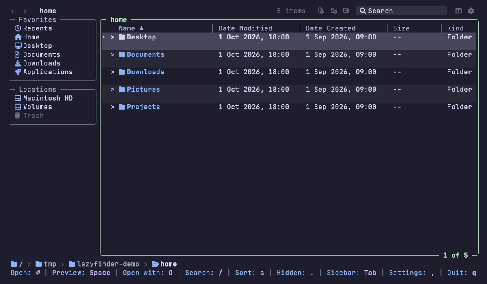

<div align="center">

# lazyfinder

**A lazy file manager for the terminal, like Finder, without leaving it.**

Columns, a sidebar, a Space preview popup and open-with, with keyboard and mouse.

[](https://github.com/MathiasDrizzy/lazyfinder/actions/workflows/ci.yml)
[](go.mod)
[](LICENSE)


[Install](#install) · [Quick start](#quick-start) · [Keys](#keys) · [Configuration](#configuration)

</div>

## Why lazyfinder

- **Looks like Finder.** A sidebar of Favorites and Locations, sortable columns, folders marked with `>`, a
  breadcrumb at the bottom and back and forward buttons.
- **Keyboard or mouse.** Click to select, double click to enter or open, wheel to scroll; every action also has a key.
- **Open with what you choose.** A `.txt` in your editor, a `.xlsx` in Excel or LibreOffice, a photo in Preview.
  Nothing runs unless you configured it.
- **Space shows what is inside.** Highlighted text, rendered Markdown, images, archives and folders, without opening
  anything.
- **Safe by default.** Deleting moves to the Trash, a taken name gets a `copy` suffix and every operation can be
  undone. Programs start without a shell, so file names cannot inject commands.

## What it does

### Browse and open

Enter folders with `Enter` or `→`, go up with `Backspace` or `←`, back and forward in history with `[` and `]`.
`Enter` on a file opens it with the program set for its extension (the system `open` by default). `M` switches to a
column view with the parent folder, the folder and a preview of the selection.



### Preview with Space

Press `Space` on a file or folder for a popup, and `↑`/`↓` to look at the next one without closing it. Text is
highlighted, Markdown is rendered, zip and tar archives list their contents (nothing is extracted), binary files show
a hex dump, audio and video show their duration and codecs, and a PDF shows its first page where the terminal can
draw images.


### Images in the preview

Pictures show inside the popup in terminals that speak the Kitty graphics protocol (Ghostty, kitty, WezTerm). Where
the terminal cannot draw them, the popup says so and `Q` opens Quick Look on macOS.


### Open with

`O` lists every program that can open the selected file, the ones you configured and a few built in (`textedit`,
`preview` and `vscode` when they are installed, and `vim`), and runs the one you pick.


### File operations

`N` makes a new folder and `n` a new file, `F2` or `R` renames, `c`, `x` and `p` copy, cut and paste, `D` duplicates,
`d` moves to the Trash and `u` undoes, on the selected row or on the rows you marked with `v`, `ctrl+a` or
ctrl-click. Nothing is deleted or overwritten for good ([ADR 0010](docs/adr/0010-file-operations.md)). `i` shows Get
Info.


### Search

`/` searches while you type, by name or by what is inside the files. `Tab` widens it from this folder to its
subfolders or the whole system, and filters such as `kind:image`, `size:` and dates narrow it; the chips under the
list add them with a click. See [docs/search.md](docs/search.md).


### Tabs, favorites and recents

`ctrl+t` opens a tab and `{` `}` move between them, `b` adds a folder to Favorites in the sidebar, `E` lists the
recent files and folders. `f` filters the folder by name, `t` tags files, `F` runs saved searches and `!` runs your
own commands from `config.json`. See [docs/keybindings.md](docs/keybindings.md).


### Sidebar mode

A narrow panel meant to sit next to your editor, like the VS Code explorer and the herdr sidebar. Start it with
`lazyfinder --sidebar [dir]`, with `Ctrl+B` in any window, or from Settings. The window switches by itself when you
resize the terminal: below 60 columns it becomes the sidebar, from 62 columns up the sidebar becomes the window again.
It works from 24 columns. The tree updates by itself (a file another program writes appears at once), shows the git
letter of each file at the right edge (`M` modified, `U` new, `A` added, `D` deleted, `R` renamed, `!` conflict) and
the branch at the bottom, and never lists `.git`.


### Git

The open folder shows the git state of each file and the branch. In the sidebar, the **Git** tab is a quick look at
what changed: the staged and unstaged changes with their counts, the stashes, the branch, and the diff of a file
(`Enter` or the `↗` button). It changes nothing: staging, committing, switching branches, pulling and pushing are left
to [lazygit](https://github.com/jesseduffield/lazygit), which `L` opens. The normal window also has a branch menu
(`B`) and a right-click menu with Stage, Unstage and Discard changes.


### Settings and themes

Press `,` (or click the gear). The 14 [lazymark](https://github.com/MathiasDrizzy/lazymark) themes
(`catppuccin-mocha` by default) and your own from `<config dir>/themes`, eight languages (English, Spanish,
Portuguese, French, German, Italian, Japanese and Chinese), the columns, the icons, the row density and more. Changes
apply at once and are saved. For one run only: `lazyfinder --theme nord --lang es --no-mouse`.


### Stay in the folder on exit

A program cannot change the folder of the shell that started it, so lazyfinder ships a shell function, as yazi and
lf do: with it, quitting leaves the shell in the folder lazyfinder ends in. Add this line to `~/.zshrc` (or `bash`, or
`fish` with `| source`):

```sh
eval "$(lazyfinder --shell-init zsh)"
```

Settings → "Stay in the folder on exit" (`cd_on_exit`) turns it off.


## Install

Install a [Nerd Font](https://www.nerdfonts.com/) in your terminal for the icons (or set `icons` to `emoji`, `ascii`
or `off`). Building needs Go 1.27.2 or newer. lazyfinder runs on macOS and Linux.

**With Go**

```sh
go install github.com/MathiasDrizzy/lazyfinder/cmd/lazyfinder@latest
```

**From source**

```sh
git clone https://github.com/MathiasDrizzy/lazyfinder.git
cd lazyfinder
go build -o lazyfinder ./cmd/lazyfinder
```

**Homebrew (macOS)**

```sh
brew install mathiasdrizzy/tap/lazyfinder
```

**Prebuilt binaries** for macOS and Linux are on the [Releases page](https://github.com/MathiasDrizzy/lazyfinder/releases).
`lazyfinder --version` prints the version you have. Each release lists its checksums in `checksums.txt`, with an SBOM
and a build provenance attestation per archive; [SECURITY.md](SECURITY.md#verifying-a-release) shows how to verify a
download.

Shell completions and the manual page:

```sh
lazyfinder --completions zsh > "${fpath[1]}/_lazyfinder"   # or bash, or fish
man ./docs/lazyfinder.1
```

## Quick start

```sh
lazyfinder              # starts in the current folder
lazyfinder ~/Projects   # starts in a folder
lazyfinder --sidebar .  # the narrow sidebar of a project
```

Press `?` for every key and gesture, `Space` to look at a file and `q` to quit.

## Keys

The essentials. `?` shows all of them, and [docs/keybindings.md](docs/keybindings.md) has the full list.

| Key | Action |
| --- | --- |
| `↑` `↓` / `k` `j` | Move the selection |
| `Enter` / `→` / `l` | Enter a folder or open a file |
| `Backspace` / `←` / `h` | Go to the parent folder |
| `[` `]` | Back and forward in history |
| `Space` / `O` | Preview popup / Open With menu |
| `/` | Search |
| `N` `n` / `F2` | New folder, new file / Rename |
| `c` `x` `p` / `d` / `u` | Copy, cut, paste / Move to the Trash / Undo |
| `ctrl+t` / `b` / `E` | New tab / Add to Favorites / Recents |
| `M` / `Ctrl+B` | Column view / Sidebar mode |
| `,` / `?` | Settings / Help |
| `q` | Quit |

Every key can be rebound with `keys` in `config.json`. The mouse does the same: click rows, headers, sidebar entries,
breadcrumb segments and the back and forward buttons.

## Configuration

Most things are in Settings (`,`) and are saved at once. The config is one JSON file: `$LAZYFINDER_CONFIG`, else
`$XDG_CONFIG_HOME/lazyfinder/config.json`, else `~/.config/lazyfinder/config.json`. Without a file the defaults apply,
and a file with only what you want to change is enough:

```json
{
  "version": 1,
  "theme": "tokyo-night",
  "openers": {
    "edit": { "argv": ["code", "{file}"], "mode": "gui" }
  },
  "open_with": { "txt": "edit", "md": "edit" }
}
```

An invalid file starts the app with the defaults and shows what is wrong. `lazyfinder --print-default-config` prints
every setting. See [docs/configuration.md](docs/configuration.md) for the openers, custom commands, themes, columns,
icons and keys.

## Compatibility

| | Status |
|---|---|
| macOS | Developed and tested here, including the interface. |
| Linux | Builds, and its tests run on every change. Not used interactively by the author yet. |
| Windows | Not supported. |

| Terminal | Images in the preview |
|---|---|
| Ghostty | ✓ tested |
| kitty, WezTerm | ✓ support the protocol, not tested |
| Any other | ✗ the popup says so; `Q` opens Quick Look on macOS |

The window needs at least 60 columns by 16 rows; the sidebar mode works from 24 columns.

## Contributing

Issues and pull requests are welcome. Run these before sending a change:

```sh
go vet ./...
go test -race ./...
```

Design decisions are in [docs/adr](docs/adr) and the requirements in [docs/SPEC.md](docs/SPEC.md). The GIFs are made
from the tapes in [assets/readme](assets/readme/CAPTURES.md), so they can be redone with `vhs`.

## License

[MIT](LICENSE)
