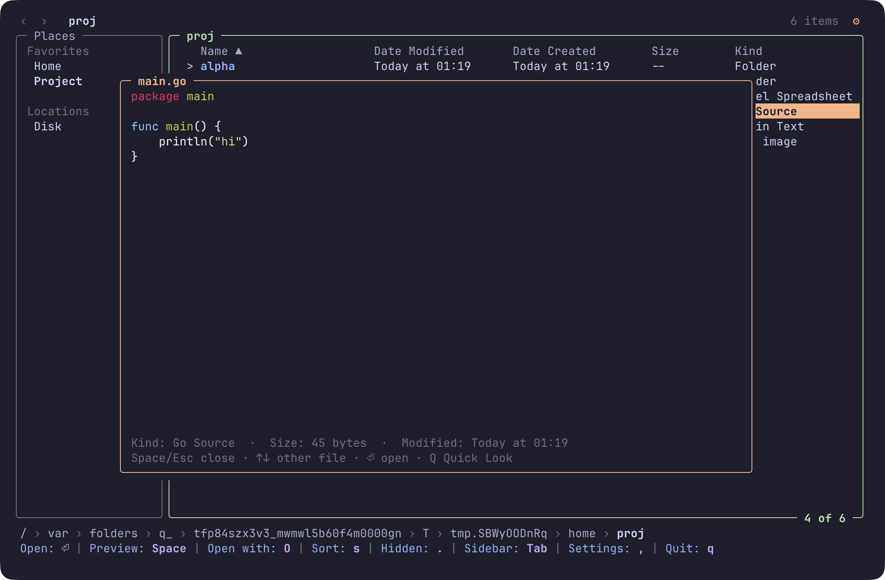
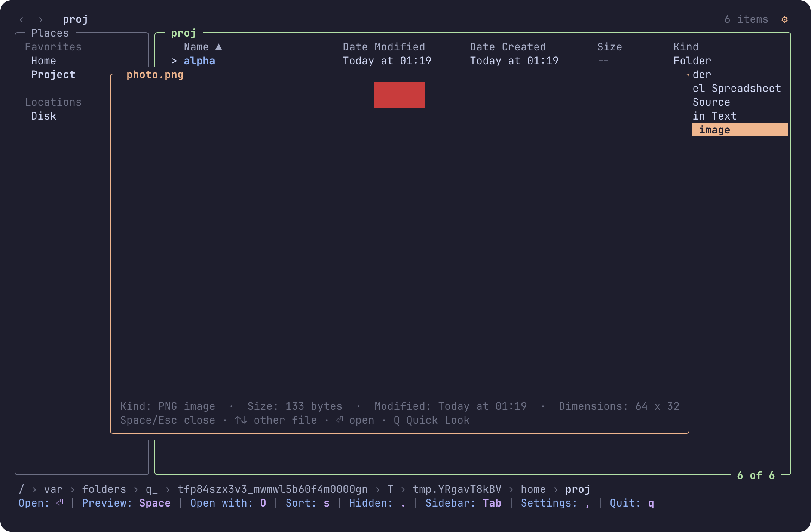
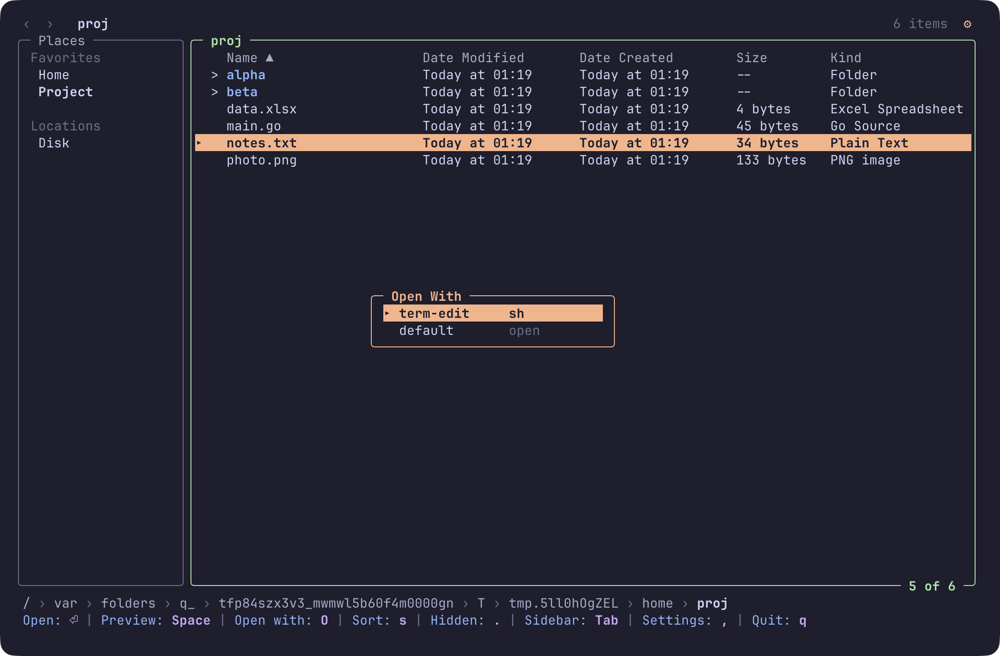
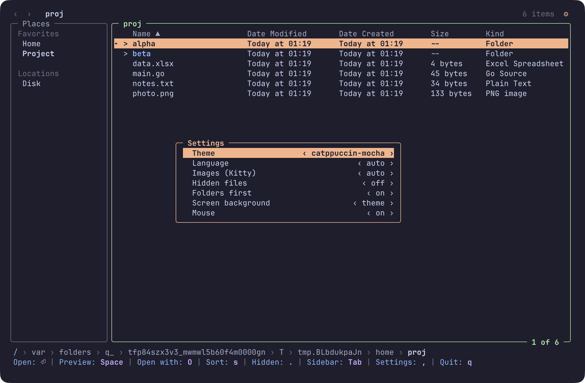
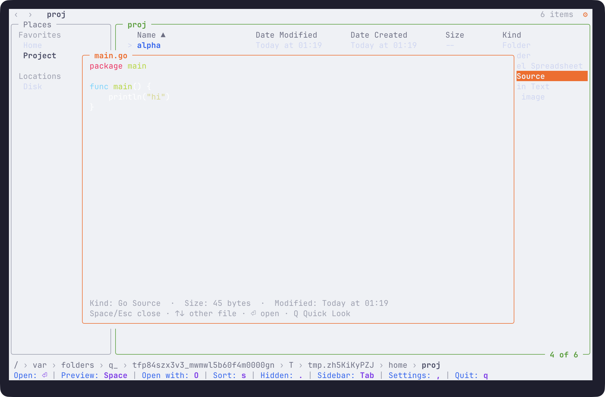
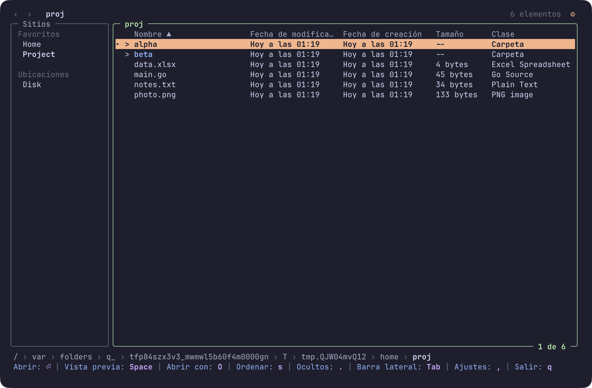

<div align="center">

# lazyfinder

**A lazy file manager for the terminal, like Finder, without leaving it.**

Columns, a sidebar, a Space preview popup and open-with, with keyboard and mouse.

[](https://github.com/MathiasDrizzy/lazyfinder/actions/workflows/ci.yml)
[](go.mod)
[](LICENSE)


[Install](#install) · [Quick start](#quick-start) · [Keys](#keys) · [Configuration](#configuration) · [Roadmap](docs/ROADMAP.md)

</div>

## Why lazyfinder

- **Looks like Finder.** A sidebar of Favorites and Locations, sortable columns, folders marked with `>`, a
  breadcrumb at the bottom and back and forward buttons.
- **Keyboard or mouse.** Click to select, double click to enter or open, wheel to scroll; every action also has a key.
- **Open with what you choose.** A `.txt` in your editor, a `.xlsx` in Excel or LibreOffice, a photo in Preview.
  Nothing runs unless you configured it.
- **Space shows what is inside.** Highlighted text, images (Kitty graphics protocol), folder contents, and Quick
  Look when your terminal cannot draw images.
- **Read-only and safe.** Version 0.x never changes your files. Programs start without a shell, so file names
  cannot inject commands.

## What it does

### Preview with Space

Press `Space` on a file or folder for a popup, and `↑`/`↓` to look at the next one without closing it.





### Open with

`Enter` opens the selected file with the program set for its extension (the system `open` by default). `O` lists
every configured program and lets you pick one.



## Install

Requires macOS or Linux and a terminal with mouse support. Images need a terminal that speaks the Kitty graphics
protocol (Ghostty, kitty, WezTerm).

```sh
go install github.com/MathiasDrizzy/lazyfinder/cmd/lazyfinder@latest
```

Or build from a clone:

```sh
go build -o bin/lazyfinder ./cmd/lazyfinder
```

## Quick start

```sh
lazyfinder            # starts in the current folder
lazyfinder ~/Projects # starts in a folder
lazyfinder --print-default-config > ~/.config/lazyfinder/config.json
```

## Keys

| Key | Action |
| --- | --- |
| `↑` `↓` / `k` `j` | Move the selection |
| `Enter` / `→` / `l` | Enter a folder or open a file |
| `Backspace` / `←` / `h` | Go to the parent folder |
| `Alt+←` `Alt+→` / `[` `]` | Back and forward in history |
| `Space` | Preview popup; `Esc` or `Space` closes it |
| `O` | Open With menu |
| `Q` | Quick Look (in the preview popup, macOS) |
| `s` / `S` | Sort by the next column / reverse the order |
| `.` | Show or hide dotfiles |
| `r` | Reload the folder |
| `Tab` | Move between the sidebar and the list |
| `,` | Settings popup (theme, language, images, ...) |
| `q` | Quit |

Every key can be rebound with `keys` in `config.json`. The mouse does the same: click rows, headers, sidebar entries, breadcrumb segments and the back and forward
buttons. The full list is in [docs/keybindings.md](docs/keybindings.md).

## Configuration

The config is one JSON file: `$LAZYFINDER_CONFIG`, else `$XDG_CONFIG_HOME/lazyfinder/config.json`, else
`~/.config/lazyfinder/config.json`. Without a file the defaults apply. An invalid file starts the app with the
defaults and shows what is wrong. See [docs/configuration.md](docs/configuration.md).

## Look, themes and languages

lazyfinder looks like Finder in what it shows and like [lazymark](https://github.com/MathiasDrizzy/lazymark) in how
it draws it: rounded panels, the accent on the focused one and a key bar at the bottom. It ships the 14 lazymark
themes (`catppuccin-mocha` by default), takes your own from `<config dir>/themes`, and speaks English, Spanish,
Portuguese, French, German, Italian, Japanese and Chinese. Press `,` (or click the gear) to change the theme,
language, image protocol and more; changes apply at once and are saved. For one run only:
`lazyfinder --theme nord --lang es --no-mouse`.







## Build and test

```sh
go vet ./...
go test -race ./...
scripts/tuiqa.sh   # end-to-end scenarios against the real binary in a pty
```

Design decisions are in [docs/adr](docs/adr) and the requirements in [docs/SPEC.md](docs/SPEC.md).

## License

[MIT](LICENSE)
